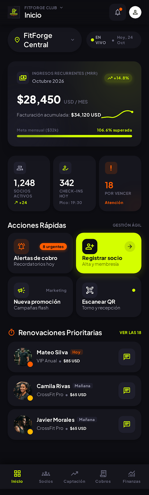

# FitForge OS - Gym Management Mobile App & Analytics

FitForge OS es una aplicación móvil web y sistema de gestión para gimnasios y centros de fitness de alto rendimiento. Incluye métricas de MRR, retención, CRM de suscriptores, alertas automatizadas y estacionalidad.



## ⚡ Características Principales

- **📊 Dashboard Financiero y Operativo**:
  - Métricas de MRR, ARR proyectado y tasa de renovación.
  - Gráfica interactiva de estacionalidad y recaudación mensual.
  - Renovaciones prioritarias urgentes (3 días, 24 horas, vencidos).
- **👥 Directorio de Socios (CRM)**:
  - Registro de nuevos socios en tiempo real con modal nativo `<dialog>` y feedback toast.
  - Filtros dinámicos por estado (*Todos, Activos, Por Vencer, Vencidos, Pausados*).
  - Búsqueda en tiempo real por nombre, teléfono o email.
  - Selector de planes (*VIP Anual, Pro Trimestral, Mensual Básico*).
- **🔔 Alertas Automatizadas de Pago**:
  - Notificaciones transaccionales vía WhatsApp Cloud API y Push FCM.
  - Audit log de envíos y disparador de cron manual.
- **📅 Captación y Estacionalidad**:
  - Detección de meses pico y valle para lanzamiento de campañas promocionales.
- **💰 Monestización y Finanzas**:
  - Desglose de ingresos por plan, cálculo de LTV y tasa de churn.

## 🛠️ Tecnologías

- **Frontend**: HTML5 Semántico, Vanilla CSS (Design Tokens de alto rendimiento atlético), JavaScript moderno (Dialog API, Canvas Chart.js).
- **Backend / APIs**: TypeScript, Express.js (`src/server.ts`), PostgreSQL DDL (`schema.sql`).

## 🚀 Ejecución en Local

Para visualizar la app de inmediato:

```bash
# Con Python
python3 -m http.server 3000

# O con Node / npx
npx serve -l 3000
```

Abre en tu navegador: [http://localhost:3000](http://localhost:3000)

## 🌐 Despliegue en GitHub Pages

Al contener `index.html` en la raíz, este repositorio es 100% compatible con **GitHub Pages**:
1. Ve a **Settings** > **Pages** en tu repositorio de GitHub.
2. Selecciona la rama `main` y la carpeta `/ (root)`.
3. Haz clic en **Save** para tener la app pública en línea.
